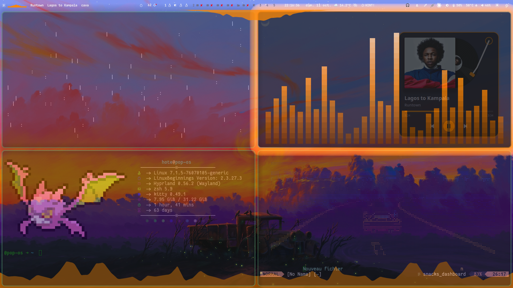

# sica-dots — Hyprland, une seule couleur

> 🇬🇧 English below

Ma config Hyprland, construite par-dessus les **KooL's Hyprland dots** de **JaKooLit** et **LinuxBeginnings**.
L'idée : **une seule couleur, la « couleur Cava »**. Tout le bureau la suit : la barre, les bordures, les menus, les notifications et le terminal. Elle peut venir du fond d'écran, d'une pipette ou de ta propre liste.




🎬 **Vidéo de présentation** : *[r/LinuxPorn](https://www.reddit.com/r/LinuxPorn/comments/1x39gya/hyprland_my_first_rice_everything_follows_one/)*

## Ce qu'il y a dedans

| | |
|---|---|
| 🎨 **Couleur Cava** | Une couleur pour tout : lue dans le fond d'écran, prise à la pipette, tapée en `#hex` ou choisie dans « ★ Mes couleurs » |
| 🌊 **Cava liquide** | Visualiseur audio en haut et en bas de l'écran, 10 styles (blocs, braille, liquide, SICA géant…) |
| 🔲 **Bordure Cava** | La bordure des fenêtres bat avec la musique |
| 🖼️ **Carrousel de fonds** | Sélecteur de fonds d'écran animé (Super+W) + **Effets +** (pixel art, teinte Cava…) |
| 💿 **Platine** | Platine vinyle sur le bureau, 4 styles : classique, verre, néon, pochette |
| 🎵 **Musique** | Grille de pochettes d'albums + **♪ Tous les titres** (recherche), fenêtre « en cours de lecture » à la couleur Cava, RofiBeats |
| 🛡️ **Barre Cyber** | Waybar séparée (Super+Alt+Y) : statut VPN / TryHackMe, copie d'IP, boîte à outils OSINT et pentest |
| 🪟 **Rofi en verre** | Thèmes `Cava-Verre-violet` et `Cava-Verre-opaque` qui suivent la couleur |
| ❓ **Aide-mémoire FR** | Tous les raccourcis en français (Super+H) |
| 🎬 **Démos vidéo** | Clips automatiques de la config, enregistrés et floutés (Super+Alt+Z) |
| 🫥 **Flou des vidéos** | Super+Alt+F pendant l'enregistrement, ou après coup, plusieurs passages d'un coup |
| 🐱 **Kitty** | Shaders, thèmes à la volée |
| 📝 **Neovim** | Dashboards, modules, Ctrl+F |
| 🪪 **Fiche perso** | Fiche de présentation dans le terminal, 7 styles |

## Installation

1. Installe d'abord les **KooL's Hyprland dots** : <https://github.com/JaKooLit/Hyprland-Dots>
2. Puis :
   ```bash
   git clone https://github.com/<ton-pseudo>/sica-dots ~/sica-dots
   cd ~/sica-dots && ./install.sh
   ```
   Tes fichiers actuels sont sauvegardés dans `~/.local/state/sica-dots-sauvegarde-…` avant d'être remplacés.

**Dépendances** : `python3-gi`, `gtk-layer-shell`, `cava`, `imagemagick`, `ffmpeg`, `wf-recorder`, `grim`, `slurp`, `hyprpicker`, `playerctl`, `mpv`, `jq`, Kitty ≥ 0.49 (pour les shaders).

**Barre Cyber (optionnelle)** : installe seulement les outils que tu veux : `nordvpn`, `openvpn`, `nmap`, `nuclei`, `whatweb`, `feroxbuster`, `dirb`, `wafw00f`, `nikto`, `sherlock`, `maigret`, `holehe`, `theHarvester`, `recon-ng`, `spiderfoot`, `exiftool`, `metasploit`, `wireshark`.

## Raccourcis principaux

| Touches | Action |
|---|---|
| Super+H | Aide-mémoire (tous les raccourcis) |
| Super+W | Carrousel de fonds d'écran |
| Super+Shift+W | Effets + |
| Clic molette sur la Cava | Menu Bureau (couleur, style, platine…) |
| Super+Ctrl+R | Thème Rofi |
| Super+Alt+Z | Démos vidéo |
| Super+Alt+F | Flouter un passage de la vidéo |
| Super+Alt+Y | Barre Cyber (bascule avec la barre principale) |
| Super+Alt+N | Choisir le dashboard Neovim |
| Super+Alt+M | Modules Neovim |
| Super+Alt+X | Thème de la statusline Neovim |
| Super+Alt+K | Shaders Kitty |
| Super+Alt+A | Mes séries (modèle : `series.exemple.txt`) |

## 🛡️ Barre Cyber (optionnelle)

Une **deuxième Waybar**, séparée de la barre principale pour ne pas la surcharger. **Super+Alt+Y** bascule de l'une à l'autre.

- **Statut en direct** : VPN du quotidien (NordVPN) et connexion TryHackMe
- **Copie de l'IP** en un clic
- **Menu « Cyber »** (Rofi en verre) : chaque outil s'ouvre dans Kitty et les résultats sont rangés dans `~/Pentest/loot`

| Catégorie | Outils |
|---|---|
| Réseau | nmap (scan du réseau local ou d'une cible), Wireshark |
| Web | Nuclei, WhatWeb, Feroxbuster, dirb, wafw00f, Nikto |
| OSINT | sherlock et maigret (pseudos), holehe (e-mails), theHarvester, recon-ng, SpiderFoot (interface web), exiftool (métadonnées) |
| Exploitation | Metasploit |
| Notes | Notes de pentest dans Neovim |

> ⚠️ **À utiliser uniquement sur tes propres machines ou sur des cibles autorisées** (TryHackMe, labos, tes tests). Scanner ou attaquer un système sans accord est illégal.

## Crédits

- **JaKooLit** et **LinuxBeginnings** : les [KooL's Hyprland dots](https://github.com/JaKooLit/Hyprland-Dots), la base de tout
- Hyprland, Waybar, Rofi, Kitty, Cava, Wallust et leurs développeurs

---

## 🇬🇧 English

My Hyprland rice, built on top of **KooL's Hyprland dots** by **JaKooLit** & **LinuxBeginnings**.
The idea: **one color, the "Cava color"**. The whole desktop follows it: bar, borders, menus, notifications and terminal. It can come from the wallpaper, an eyedropper or your own list.

**Features**: liquid Cava visualizer (10 styles) · Cava border pulsing with music · animated wallpaper carousel + Effects+ · desktop turntable (4 styles) · album grid with an "All tracks" view & now-playing window (Cava-colored) · glass Rofi themes following the color · French cheat sheet (Super+H) · automatic demo clips with recording & blur · Kitty shaders · Neovim dashboards · terminal profile card · optional Cyber bar (Super+Alt+Y).

**Install**: install KooL's Hyprland dots first, then `git clone` this repo and run `./install.sh` (your current files are backed up first).

**Cyber bar (optional)**: a second Waybar (toggle with Super+Alt+Y) with VPN / TryHackMe status, IP copy and a Rofi toolbox that runs tools in Kitty and saves results to `~/Pentest/loot`: nmap, Wireshark · Nuclei, WhatWeb, Feroxbuster, dirb, wafw00f, Nikto · sherlock, maigret, holehe, theHarvester, recon-ng, SpiderFoot, exiftool · Metasploit. Install only the tools you want.
⚠️ Use them only on your own machines or on targets you are authorized to test (TryHackMe, labs).

**Credits**: JaKooLit & LinuxBeginnings for [KooL's Hyprland dots](https://github.com/JaKooLit/Hyprland-Dots).
